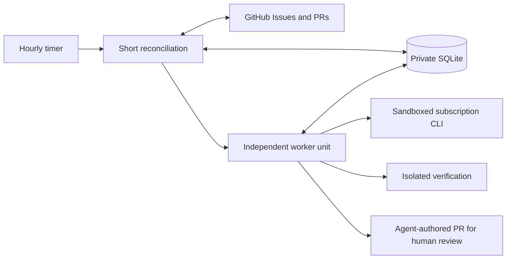

# Architecture and decisions

## ADR 1: subscription CLI is the inference boundary

Use the installed standalone Codex CLI 0.171.0 rather than add an SDK or a service.
No Codex TypeScript SDK was installed in the inspected global toolchain or repo.
`exec --json` creates sessions and emits `thread.started`, agent messages, error
events and completion events. `exec resume SESSION_ID` supports a subsequent turn
on a persisted session. Both paths were exercised with ChatGPT login. This does
not establish that a still-running turn can be attached to or that every damaged
session can resume. Supervisor state is checked before any continuation.

The adapter rejects a non-ChatGPT `auth_mode`, forces `forced_login_method` and the
OpenAI subscription provider, ignores user config and exec rules, supplies no API
keys, and has no fallback provider. Approvals are `never`: denied work must stop,
not silently increase privilege. JSONL events persist session IDs immediately.
The owner can repeat both integration probes without implementing an issue.

## ADR 2: SQLite owns coordination, systemd owns processes

Transactions use `BEGIN IMMEDIATE`, a busy timeout, WAL and a unique partial index
for the single unfinished coding slot. Waiting questions and terminal executions
do not occupy that slot. Process locks include Linux boot ID, PID and kernel
start time, avoiding PID-reuse and stale-reboot confusion. Only the holder can
release a lock. All persistent transitions generate metadata audit events.

The wake command inspects the supervisor before trusting heartbeats. It never
holds a process open waiting for Codex. A queued execution is recorded before
starting systemd; starting an existing unit is idempotent. Worker-level locking
also prevents accidental duplicate manual invocations. Retry budgets are durable.

## ADR 3: trusted code owns side effects

The model edits only its isolated worktree. Bubblewrap hides the host home,
GitHub credentials, deployment configuration, other worktrees, state and release.
Codex's named permission profile denies tool access to `/codex-home` and disables
tool networking. The outer CLI retains subscription connectivity. The source
`.codex` directory is masked so issue-authored project configuration cannot weaken
the selected policy. No unrestricted sandbox fallback is implemented.

Trusted code verifies identity, commits with hooks disabled, pushes through an
explicit gh credential helper, and creates a linked PR requesting Yamatoberu.
Untrusted code verification runs with dummy CI variables and no host credentials.
Dependency installation has network and disables package scripts; verification
has no network. Protected path changes require an explicit issue-specific owner
configuration grant. The deployed release/config remain read only to model tools.

The supported Codex permission-profile syntax is described in the
[official permissions documentation](https://learn.chatgpt.com/docs/permissions).
Exact installed behavior is verified separately; documentation alone is not a
substitute for the host integration tests.

## ADR 4: conservative readiness and human business authority

Labels, documented acceptance criteria and dependency closure are deterministic
gates. Existing branches/linked PRs and execution history suppress duplicates.
The worker performs contextual technical readiness reasoning before editing.
The engineering manager gives a technical question one continuation, then asks
for human clarification if still unresolved. Business answers require an exact
execution marker from the repository owner. Persisted answers become proposed
version-controlled decision entries in the issue PR.

Future extension seams are the GitHub/supervisor ports and the Codex adapter.
An independent reviewer could inspect a verified candidate before the existing PR
publication step; no extra reviewer agent or inference framework is installed.
